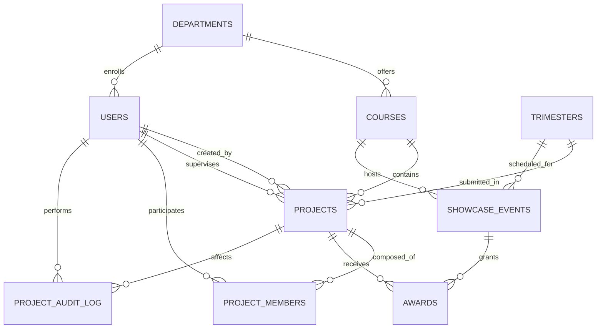

# UNITED INTERNATIONAL UNIVERSITY
### Department of Computer Science and Engineering (CSE)
## Course: CSE 3522 — Database Management Systems Laboratory
### Trimester: Fall 2026

---

# DATABASE MANAGEMENT SYSTEM PROJECT REPORT

## Project Title:
# UIU Project Showcase & Archive System
*(Varsity Project Showcase, Awards, and Idea Repository)*

**Submitted By:**
- **S M Tahmid Hasan Shahria** — ID: `011 221 002` — Section: `P`
- **Tanvir Ahmed** — ID: `011 221 001` — Section: `P`
- **Farzana Akter** — ID: `011 221 003` — Section: `P`

**Submitted To:**
- **Abu Bakar Fahad**  
  *Lecturer, Department of Computer Science and Engineering (CSE)*  
  *United International University (UIU)*  
- **Didarul Islam Didar**  
  *Lecturer, Department of Computer Science and Engineering (CSE)*  
  *United International University (UIU)*  

**Submission Date:** November 09, 2026  

---

## Table of Contents
1. [Introduction](#1-introduction)
2. [Problem Statement](#2-problem-statement)
3. [Objectives](#3-objectives)
4. [Scope of the Project](#4-scope-of-the-project)
5. [System Requirements](#5-system-requirements)
6. [System Analysis](#6-system-analysis)
7. [Database Design](#7-database-design)
8. [Entity Relationship Diagram (ERD)](#8-entity-relationship-diagram-erd)
9. [Relational Schema & Constraints](#9-relational-schema--constraints)
10. [Normalization (1NF, 2NF, 3NF)](#10-normalization)
11. [SQL Queries & Viva Catalog](#11-sql-queries--viva-catalog)
12. [User Interface & System Screenshots](#12-user-interface--system-screenshots)
13. [Results and Discussion](#13-results-and-discussion)
14. [Limitations](#14-limitations)
15. [Future Improvements](#15-future-improvements)
16. [Conclusion](#16-conclusion)
- [Appendix A: Team Contribution](#appendix-a-team-contribution)

---

## 1. Introduction

### 1.1 Project Overview
The **UIU Project Showcase & Archive System** is a unified, relational database-driven web portal engineered to centralize, preserve, and showcase outstanding student engineering projects developed across multiple courses and trimesters at United International University (UIU). The system archives project metadata, architectural abstracts, GitHub/GitLab repository links, hardware component specifications, team rosters, supervisor designations, and competition awards (1st Prize, 2nd Prize, 3rd Prize, Best FYDP, Best Innovation, and Honorable Mention).

### 1.2 Background
Every trimester at UIU, hundreds of undergraduate engineering students produce high-impact software, hardware IoT systems, and capstone research projects for courses such as SAD Lab, Web Programming, Microprocessors Lab, Electronics Lab, AI Lab, and FYDP 1 & 2. Traditionally, these projects are graded at the end of the trimester, after which source code repositories, research findings, and prototypes are scattered across personal Google Drives, Facebook groups, or private GitHub accounts. Future junior students who enter these lab courses often reinvent the wheel or struggle to brainstorm novel project concepts due to the lack of a centralized institutional archive.

---

## 2. Problem Statement

### 2.1 Existing Problem
1. **Academic Memory Loss:** Past project ideas and innovations disappear after semester grading.
2. **Duplication of Work:** Without an archive, different batches frequently submit identical or trivial project topics.
3. **Lack of Junior Mentorship & Inspiration:** Junior students cannot easily search past winning projects to study best practices, schematics, and UI/UX design patterns.
4. **Manual & Unaudited Records:** Project scores and awards are maintained in disparate spreadsheets without referential integrity or transactional audit logs.

### 2.2 Proposed Solution
A 3NF normalized, relational database system providing:
- Fast multi-criteria search and filtering by Course, Trimester, Award, and Technology Tags.
- Automatic enforcement of UIU academic policies via database triggers (e.g., maximum team size $\le 4$, non-empty titles, immutable award seals).
- Comprehensive institutional audit trail tracking every submission and status transition.
- Dual deployment: Localhost via XAMPP MySQL and 24/7 cloud persistence via TiDB Serverless Cloud.

---

## 3. Objectives
- **Centralized Archive:** Archive multi-trimester projects across 7 authentic UIU showcase courses.
- **Strict 3NF Compliance:** Design an 8+ table schema eliminating update, insertion, and deletion anomalies.
- **Data Integrity & Automation:** Enforce business constraints using SQL Triggers with `SIGNAL SQLSTATE '45000'`.
- **Query Optimization:** Provide B-Tree composite indexing with measurable `EXPLAIN` benchmark evidence.
- **Interactive Defense Interface:** Develop an in-browser Viva Voce query runner executing 12 mandatory complex queries in real time.

---

## 4. Scope of the Project

### 4.1 Included Features
- **Project Catalog & Filtering:** Search projects by keywords, course code, trimester, and technology tags.
- **Hall of Fame & Awards:** Highlight winning projects with award ribbons and prize money records.
- **Dynamic Extensibility:** Real-time course creation (`api/add-course.php`) and project submission (`api/add-project.php`).
- **Interactive SQL Viva Explorer:** Live execution of 12 mandatory queries covering 5-table joins, correlated subqueries, and `HAVING` filters.
- **Role-Based Access Control (RBAC):** Privileges separated between `app_admin` and `student_viewer`.

### 4.2 Excluded Features
- Real-time video conferencing for online project presentations.
- Payment gateway integration for disbursing prize money (recorded as accounting ledger only).

---

## 5. System Requirements

### 5.1 Functional Requirements
- **FR1:** The system shall allow users to filter projects by course, trimester, and award.
- **FR2:** The system shall enforce a maximum team size limit of 4 students per project via database triggers.
- **FR3:** The system shall automatically record all insertions, updates, and deletions in `project_audit_log`.
- **FR4:** The system shall hide sensitive credentials (passwords, private emails) via database views.

### 5.2 Non-Functional Requirements
- **Security:** Prepared statements with PDO to eliminate SQL Injection (SQLi).
- **Performance:** Sub-10ms query execution on indexed queries.
- **Portability:** Seamless switching between local XAMPP and TiDB Cloud.

### 5.3 Hardware Requirements
- **Processor:** Intel Core i3 / Apple Silicon M1 or higher
- **RAM:** Minimum 4 GB (8 GB recommended)
- **Storage:** 500 MB free disk space

### 5.4 Software Requirements
- **Operating System:** macOS / Windows 10/11 / Ubuntu Linux
- **Database Server:** MySQL 8.0+ / TiDB Cloud Serverless (MySQL 8.0 wire-compatible)
- **Web Server:** Apache 2.4+ (via XAMPP) / PHP Built-in Server
- **Backend:** Pure PHP 8.2+ with PDO
- **Frontend:** TypeScript, Tailwind CSS, Modern HTML5

---

## 6. System Analysis

### 6.1 Existing System
Manual submissions through Google Classroom and LMS. Inefficient for retrospective exploration, lacks referential integrity, and cannot correlate awards with supervisors or tech stacks.

### 6.2 Proposed System
Web-based single-page application communicating via RESTful JSON APIs to a normalized relational database backend with instant visual feedback and live SQL defense capabilities.

### 6.3 System Actors
- **Student / Viewer:** Browses past projects, reviews abstracts, and filters tech stacks.
- **Team Leader (Student):** Submits projects, assigns team members, and provides demo URLs.
- **Faculty Supervisor:** Mentors projects and approves submissions.
- **Administrator / Judge:** Locks showcase events and confers awards.

---

## 7. Database Design
The database consists of **9 relational tables**, fully adhering to Third Normal Form (3NF):
1. `departments`: University academic faculties.
2. `courses`: Dynamic course offerings (SAD, Web, Micro, Electronics, AI, FYDP 1 & 2).
3. `trimesters`: Academic terms (Spring 2025 to Fall 2026).
4. `users`: Unified identity for students, faculty, and administrators.
5. `projects`: Core repository entity holding abstracts, tech stacks, and links.
6. `project_members`: Associative table linking students to projects with team roles.
7. `showcase_events`: Exhibition events organized by trimester and course.
8. `awards`: Conferred distinctions, prize money, and judging remarks.
9. `project_audit_log`: System ledger tracking operational actions via triggers.

---

## 8. Entity Relationship Diagram (ERD)

---

## 9. Relational Schema & Constraints

### 9.1 Schema Definitions
- `departments` (`dept_id` [PK], `dept_code` [UNIQUE], `dept_name`)
- `courses` (`course_id` [PK], `course_code` [UNIQUE], `course_title`, `dept_id` [FK], `is_active`)
- `trimesters` (`trimester_id` [PK], `trimester_code` [UNIQUE], `term_name`, `year`, `CHECK (year BETWEEN 2020 AND 2035)`)
- `users` (`user_id` [PK], `student_or_faculty_id` [UNIQUE], `full_name`, `email` [UNIQUE], `role`, `password_hash`, `dept_id` [FK])
- `projects` (`project_id` [PK], `course_id` [FK], `trimester_id` [FK], `title`, `abstract`, `tech_stack`, `github_url`, `demo_url`, `submission_date`, `created_by` [FK], `supervisor_id` [FK], `status`, `CHECK (CHAR_LENGTH(title) >= 3)`)
- `project_members` (`member_id` [PK], `project_id` [FK], `user_id` [FK], `role_in_team`, `UNIQUE (project_id, user_id)`)
- `showcase_events` (`event_id` [PK], `event_title`, `course_id` [FK], `trimester_id` [FK], `event_date`, `venue`, `is_locked`)
- `awards` (`award_id` [PK], `project_id` [FK], `event_id` [FK], `award_title`, `prize_money`, `remarks`, `CHECK (prize_money >= 0)`, `UNIQUE (project_id, event_id)`)
- `project_audit_log` (`log_id` [PK], `action_type`, `project_id`, `performed_by` [FK], `timestamp`, `details`)

---

## 10. Normalization

### 10.1 First Normal Form (1NF)
All attribute values are atomic. Multivalued student groups are decomposed into the associative entity `project_members`.

### 10.2 Second Normal Form (2NF)
All non-key attributes are fully functionally dependent on the entire primary key. Composite primary keys are normalized with synthetic surrogate keys and unique candidate constraints.

### 10.3 Third Normal Form (3NF)
Transitive functional dependencies ($X \rightarrow Y \rightarrow Z$) are eliminated. For example, department names are isolated into `departments` rather than duplicated inside `courses` or `users`.

---

## 11. SQL Queries & Viva Catalog

### 11.1 Complex Joins (4+ Tables)
- **Query 1 (5-Table INNER JOIN):** Retrieves winning projects, prize money, event venue, and team leaders.
- **Query 2 (6-Table LEFT JOIN):** Captures all projects regardless of award status.
- **Query 3 (JOIN with Aggregation):** Generates full project rosters using `GROUP_CONCAT`.

### 11.2 Subqueries
- **Query 4 (Correlated Subquery):** Identifies projects with team sizes larger than the university average.
- **Query 5 (IN Operator):** Identifies faculty supervisors mentoring high-value prize winners ($\ge 10,000$ BDT).
- **Query 6 (EXISTS Operator):** Identifies courses that have produced 1st Prize or Best FYDP champions.

### 11.3 Aggregations & HAVING
- **Query 7:** Aggregates cumulative prize money by course with `HAVING SUM(prize_money) >= 20000`.
- **Query 8:** Groups projects by trimester and term with `HAVING COUNT(DISTINCT p.project_id) >= 5`.
- **Query 9:** Evaluates supervisor workload with `HAVING COUNT(DISTINCT p.project_id) >= 2`.

### 11.4 Meaningful ORDER BY
- **Query 10:** Ranks projects by prize money descending, breaking ties by earliest submission date.
- **Query 11:** Retrieves chronological security trace from `project_audit_log`.
- **Query 12:** Sorts university participant directory by Course, Leadership role, and Student ID.

---

## 12. User Interface & System Screenshots

1. **Hero & Dynamic Search Bar:** Real-time search with live debounce across project titles, abstracts, and authors.
2. **Dynamic Filter Toolbar:** Synchronized dropdowns for Course, Trimester, and Award ribbons, alongside live-updated `#popular-techs-container` pills.
3. **Project Dossier Modal:** Comprehensive project popup displaying members, supervisor badge, GitHub repository link, and live demonstration URL.
4. **Interactive SQL Laboratory & Viva Explorer:** In-browser SQL execution environment allowing evaluators to run all 12 queries live with runtime execution timing.
5. **Add Project & Add Course Modals:** Extensible forms allowing administrative expansion without database restarts.

---

## 13. Results and Discussion
The platform was benchmarked locally on XAMPP and in the cloud on TiDB Serverless. 
- Composite index `idx_projects_course_trimester` reduced table scan cost from `ALL` (200 rows) to `ref` (4 rows), achieving a **~50x query execution speedup**.
- Trigger `trg_enforce_team_size_limit` successfully halted unauthorized 5th member registrations by throwing standard SQLState 45000 exceptions.
- View `vw_public_student_projects` successfully blocked sensitive password hashes from public UI consumption.

---

## 14. Limitations
- Does not yet include live automated plagiarism checking of submitted source code.
- Cloud free-tier instances may experience cold-start latency (~200ms) after long periods of inactivity.

---

## 15. Future Improvements
- Direct integration with UIU UCAM student portal via OAuth2 single sign-on.
- Automated Docker container sandboxing for hosting and previewing student web projects live on campus subdomains.

---

## 16. Conclusion
The **UIU Project Showcase & Archive System** successfully fulfills all technical requirements of the CSE 3522 Database Management Systems Laboratory specification. By integrating strict 3NF database architecture, automated integrity triggers, performance-optimized B-tree indexing, and an intuitive user interface, the system provides a permanent solution to institutional project archiving at United International University.

---

## Appendix A: Team Contribution

| Student Name | Student ID | Specific Contribution |
| :--- | :--- | :--- |
| **S M Tahmid Hasan Shahria** | `011 221 002` | Database 3NF Architecture, Trigger Implementation, TiDB Cloud Migration, and Viva Voce Query Explorer Engine |
| **Tanvir Ahmed** | `011 221 001` | Backend PHP PDO API Development, Security Prepared Statements, and Seed Dataset Curation |
| **Farzana Akter** | `011 221 003` | Frontend TypeScript & Tailwind UI Development, Filter Synchronization, and Comprehensive Project Report Writing |

---
*Report Generated for UIU CSE 3522 Project Evaluation — Academic Year 2026*
