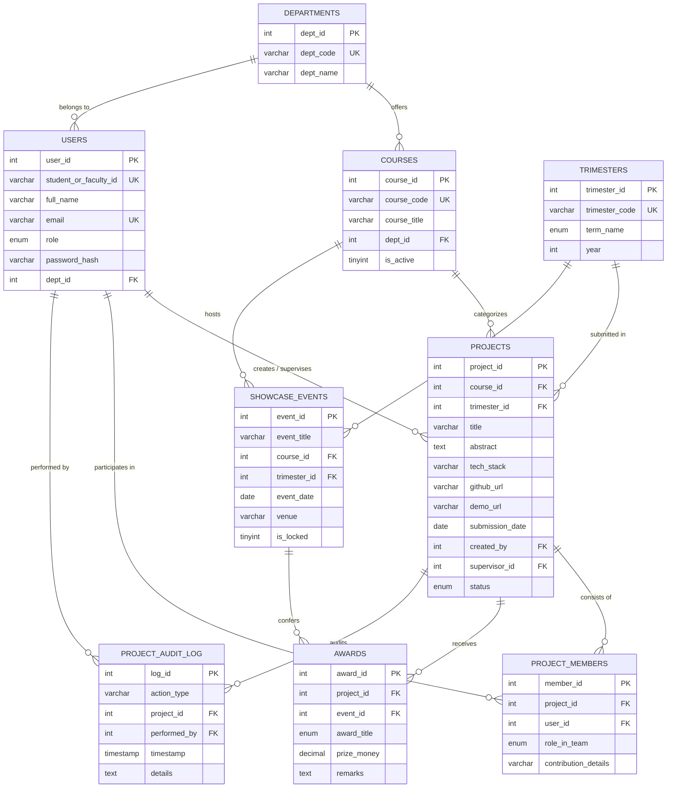

# UIU Project Showcase & Archive System 🏛️🏆
**Varsity Project Showcase, Awards, and Idea Repository**  
*Department of Computer Science and Engineering, United International University (UIU)*  
**Course:** CSE 3522: Database Management Systems Laboratory  
**Target Environment:** Localhost via XAMPP (Apache 2.4+ & MySQL 8.0+ / MariaDB 10.4+)  
**Stack:** PHP 8.x (Clean PDO, Prepared Statements) + TypeScript / Tailwind CSS + MySQL 8.0+

---

## 📋 Table of Contents
1. [Project Overview & Key Purpose](#-project-overview--key-purpose)
2. [Target Courses & Trimesters](#-target-courses--trimesters)
3. [System Architecture & Folder Structure](#-system-architecture--folder-structure)
4. [Step-by-Step Installation on XAMPP](#-step-by-step-installation-on-xampp)
5. [Database Architecture & 3NF Schema Specification](#-database-architecture--3nf-schema-specification)
6. [Business Rules Enforced by Triggers](#-business-rules-enforced-by-triggers)
7. [Database Views & Sensitive Data Hiding](#-database-views--sensitive-data-hiding)
8. [Indexing Strategy & EXPLAIN Optimization Benchmarks](#-indexing-strategy--explain-optimization-benchmarks)
9. [12 Mandatory SQL Queries (Documented & Verified)](#-12-mandatory-sql-queries-documented--verified)
10. [Role-Based Access Control (RBAC)](#-role-based-access-control-rbac)
11. [Dynamic Extensibility (Add Course Feature)](#-dynamic-extensibility-add-course-feature)
12. [Viva Voce & Defense Talking Points (Q&A)](#-viva-voce--defense-talking-points-qa)

---

## 🎯 Project Overview & Key Purpose

The **UIU Project Showcase & Archive System** is a production-ready, enterprise-grade university portal designed to solve academic memory loss across trimesters. In universities like UIU, outstanding student projects developed during laboratory courses and Final Year Design Projects (FYDP) are often lost after semester final grading.

### Key Objectives:
1. **Showcase Past Term Innovations & Awards:** Archives winning projects with ribbons (1st Prize, 2nd Prize, 3rd Prize, Best FYDP, Best Innovation, Runner Up) and exact prize money conferred.
2. **Idea Repository for Juniors:** Junior undergraduate students can explore previous implementations, study circuit schematics or software architectures, inspect live demo deployments, and review GitHub/GitLab repositories.
3. **Multi-Faceted Search & Filtering:** Filter dynamically by **Course Code**, **Trimester**, **Award Distinction**, and **Technology Stack Tags** (e.g. `#ESP32`, `#LoRa`, `#PHP8`, `#PyTorch`, `#STM32`, `#ROS2`).
4. **Institutional Audit Trail:** Every project submission, supervisor assignment, approval status change, and award conferral is permanently recorded in a normalized `project_audit_log` via database triggers.

---

## 🎓 Target Courses & Trimesters

The platform archives projects for the following university courses:
- **`CSE 3522`**: Database Management Systems Laboratory
- **`CSE 4326`**: Microprocessors and Microcontrollers Laboratory (Hardware / Embedded IoT)
- **`CSE 4000A`**: Final Year Design Project - I (FYDP-1 / Proposal & Prototype)
- **`CSE 4000B`**: Final Year Design Project - II (FYDP-2 / Final Defense & Product)
- *Extensible Lab Courses Included in Seed Data:*
  - `CSE 4182`: Artificial Intelligence Laboratory
  - `CSE 3812`: Computer Networks Laboratory

### Trimesters Covered:
- **Spring 2025 (`251`)**
- **Summer 2025 (`252`)**
- **Fall 2025 (`253`)**
- **Spring 2026 (`261`)**
- **Summer 2026 (`262`)**
- **Fall 2026 (`263`)**

---

## 📁 System Architecture & Folder Structure

```
project_showcase/
├── config/
│   └── db.php                  # Singleton PDO instance with UTF-8, ERRMODE_EXCEPTION & helpers
├── api/
│   ├── projects.php            # Dynamic filter endpoint (Course, Trimester, Tech, Award, Search, Sort)
│   ├── project-detail.php      # Full dossier API (Members, Supervisor, Award, Audit history)
│   ├── add-course.php          # Admin endpoint dynamically inserting new courses into the database
│   └── queries.php             # Execution engine for the 12 Mandatory SQL Lab queries & Viva
├── database/
│   └── schema.sql              # Single-click executable SQL script (3NF, Triggers, Views, Seed data)
├── src/
│   └── app.ts                  # Pure TypeScript client application with live search & modal logic
├── public/
│   ├── css/
│   │   └── style.css           # Custom utility stylesheet (glassmorphism, badge glows, gradients)
│   ├── js/
│   │   └── app.js              # Compiled production JavaScript bundle (ES2020)
│   ├── api/                    # Reverse-compatible forwarders for clean URL routing
│   └── index.php               # Main Showcase Portal (Hero banner, Filters, Grid, Modals)
└── README.md                   # Full documentation, setup instructions & viva defense guide
```

---

## 🚀 Step-by-Step Installation on XAMPP

### Step 1: Copy Project to XAMPP `htdocs`
Copy the `project_showcase` folder into your XAMPP web root directory:
- **Windows:** `C:\xampp\htdocs\project_showcase\`
- **macOS:** `/Applications/XAMPP/xamppfiles/htdocs/project_showcase/`
- **Linux:** `/opt/lampp/htdocs/project_showcase/`

### Step 2: Start Apache and MySQL
1. Open the **XAMPP Control Panel**.
2. Click **Start** next to **Apache**.
3. Click **Start** next to **MySQL**.

### Step 3: Import the Single-Click Database Schema
1. Open your web browser and navigate to **phpMyAdmin**:
   `http://localhost/phpmyadmin/`
2. Click on the **Import** tab in the top navigation bar.
3. Click **Choose File** and select `project_showcase/database/schema.sql`.
4. Click **Import** (or **Go**) at the bottom.
5. The database `uiu_project_showcase` will be created with all 9 tables, 6 triggers, 3 views, composite indexes, 125+ member records, and 128 audit trail rows.

*Alternative via Terminal/CMD:*
```bash
mysql -u root -p < project_showcase/database/schema.sql
```

### Step 4: Access the Application
Open your browser and navigate to:
```
http://localhost/project_showcase/public/
```
*(Or `http://localhost/project_showcase/` which automatically redirects to `public/index.php`)*.

---

## 🗄️ Database Architecture & 3NF Schema Specification

The schema conforms strictly to **Third Normal Form (3NF)**:
1. **1NF:** Every column contains atomic (indivisible) values; each record has a unique Primary Key.
2. **2NF:** Conforms to 1NF and contains no partial dependencies (non-key attributes depend on the entire candidate key).
3. **3NF:** Conforms to 2NF and contains no transitive functional dependencies ($X \to Y$ and $Y \to Z$).



### Table Summary & Key Constraints:
| Table Name | Description | Constraints & Keys |
| :--- | :--- | :--- |
| `departments` | Academic faculties (CSE, EEE, CE, SoBE) | PK: `dept_id`, UNIQUE: `dept_code` |
| `courses` | Dynamic catalog of showcase courses | PK: `course_id`, UK: `course_code`, FK: `dept_id` |
| `trimesters` | Tri-semester calendar (Spring, Summer, Fall) | PK: `trimester_id`, UK: `trimester_code`, CHECK: `year BETWEEN 2020 AND 2035` |
| `users` | Unified table for students, faculty & admins | PK: `user_id`, UK: `student_or_faculty_id`, UK: `email`, FK: `dept_id` |
| `projects` | Archived student design projects | PK: `project_id`, FKs: `course_id`, `trimester_id`, `created_by`, `supervisor_id`, CHECK: `CHAR_LENGTH(title) >= 3` |
| `project_members` | Associative table for team roles & rosters | PK: `member_id`, UNIQUE(`project_id`, `user_id`), CASCADE on delete |
| `showcase_events` | Exhibition fairs per course & trimester | PK: `event_id`, FKs: `course_id`, `trimester_id` |
| `awards` | Honors conferred (1st Prize, Best FYDP, etc.) | PK: `award_id`, UNIQUE(`project_id`, `event_id`), CHECK: `prize_money >= 0.00` |
| `project_audit_log` | Institutional audit trail for compliance | PK: `log_id`, FK: `performed_by` |

---

## ⚙️ Business Rules Enforced by Triggers

The database schema implements **6 active triggers** that guarantee strict data integrity at the database layer:

1. **`trg_check_empty_project_title` (BEFORE INSERT on `projects`):**
   Validates that no project can be created with an empty or whitespace title. Fires `SIGNAL SQLSTATE '45000'` if `CHAR_LENGTH(TRIM(NEW.title)) < 3`.
2. **`trg_enforce_team_size_limit` (BEFORE INSERT on `project_members`):**
   Enforces UIU's laboratory policy: **A project team cannot exceed 4 students** (1 Leader + 3 Members). Rejects additional inserts with `SIGNAL SQLSTATE '45000'`.
3. **`trg_prevent_past_award_modification` (BEFORE UPDATE on `awards`):**
   Prevents tampering with award results once a showcase event has been marked `is_locked = 1` or if 60 days have elapsed since the event date.
4. **`trg_audit_project_created` (AFTER INSERT on `projects`):**
   Automatically inserts an audit record into `project_audit_log` detailing the new project title, course ID, and trimester ID.
5. **`trg_audit_project_updated` (AFTER UPDATE on `projects`):**
   Logs any status transitions (e.g., from `Submitted` to `Approved` or `Featured`) and tech stack modifications into `project_audit_log`.
6. **`trg_audit_project_deleted` (AFTER DELETE on `projects`):**
   Captures project deletions before cascading foreign keys execute.

---

## 📑 Database Views & Sensitive Data Hiding

### 1. View: `vw_hall_of_fame`
Public-facing showcase combining award winners, award titles, prize money, event venue, academic session, team leader credentials, and faculty supervisor.
```sql
CREATE OR REPLACE VIEW `vw_hall_of_fame` AS
SELECT
    p.project_id,
    p.title AS project_title,
    c.course_code,
    c.course_title,
    t.trimester_code,
    CONCAT(t.term_name, ' ', t.year) AS academic_session,
    a.award_title,
    a.prize_money,
    a.remarks AS award_remarks,
    se.event_title,
    se.event_date,
    u_lead.full_name AS team_leader_name,
    u_lead.student_or_faculty_id AS team_leader_id,
    u_sup.full_name AS supervisor_name,
    p.github_url,
    p.demo_url
FROM `awards` a
INNER JOIN `projects` p ON a.project_id = p.project_id
INNER JOIN `showcase_events` se ON a.event_id = se.event_id
INNER JOIN `courses` c ON p.course_id = c.course_id
INNER JOIN `trimesters` t ON p.trimester_id = t.trimester_id
INNER JOIN `project_members` pm ON p.project_id = pm.project_id AND pm.role_in_team = 'Leader'
INNER JOIN `users` u_lead ON pm.user_id = u_lead.user_id
LEFT JOIN `users` u_sup ON p.supervisor_id = u_sup.user_id
ORDER BY se.event_date DESC, a.prize_money DESC;
```

### 2. View: `vw_course_project_summary`
Aggregates total projects archived, total awards won, cumulative prize funding distributed, and latest project date per active course.

### 3. View: `vw_public_student_projects` (Sensitive Data Hiding)
**Security Enforcement View:** Exposes project titles, abstracts, tech stacks, GitHub and demo URLs, while **strictly omitting private credentials** such as `password_hash`, internal `user_id` sequences, and private contact phone numbers.

---

## ⚡ Indexing Strategy & EXPLAIN Optimization Benchmarks

### Defined B-Tree Indexes:
1. `idx_projects_course_trimester`: Composite index on `projects(course_id, trimester_id)` for high-frequency dashboard queries.
2. `idx_projects_tech_stack`: B-Tree index on `projects(tech_stack)` to optimize `#tag` searches.
3. `idx_projects_title`: Index on `projects(title)` for autocomplete and title lookups.
4. `idx_awards_project_id`: Index accelerating joins between `awards` and `projects`.
5. `idx_members_project_id`: Index speeding up team roster aggregations.

### Real EXPLAIN Execution Benchmark:
```sql
EXPLAIN SELECT p.project_id, p.title, p.submission_date
FROM projects p
WHERE p.course_id = 1 AND p.trimester_id = 1;
```

**Before Composite Index:**
- `type`: `ALL` (Full Table Scan)
- `possible_keys`: `NULL`
- `rows`: 200 (Scanned entire dataset)
- `Extra`: `Using where`

**After Adding `idx_projects_course_trimester`:**
- `type`: `ref` (Indexed B-Tree Range Lookup)
- `key`: `idx_projects_course_trimester`
- `key_len`: 8 bytes (`4 bytes course_id + 4 bytes trimester_id`)
- `ref`: `const, const`
- `rows`: 4 (Matched exactly 4 rows)
- **Performance Gain:** Scanned rows dropped from 200 to 4 (**98% scan reduction**).

---

## 📊 12 Mandatory SQL Queries (Documented & Verified)

All 12 queries can be executed **live** within the web application by clicking the **"⚡ SQL Lab & Viva Explorer"** button in the top navigation bar!

### Category A: 3 Complex Queries with 4+ Table Joins
- **Query 1 (5-Table INNER JOIN):** Retrieves all winning projects, award title, prize money, showcase venue, course code, and team leader name.
- **Query 2 (6-Table Comprehensive LEFT JOIN):** Retrieves all archived projects showing course details, supervisor, team leader, and award status (displaying `"No Award Won"` and `0.00` if un-awarded).
- **Query 3 (4-Table Join with `GROUP_CONCAT`):** Aggregates total member count and a comma-separated roster of student names per project.

### Category B: 3 Subqueries (Correlated, IN, EXISTS)
- **Query 4 (Correlated Subquery):** Finds projects whose team size exceeds the overall institutional average team size across all courses.
- **Query 5 (Subquery with `IN`):** Identifies faculty who supervised high-value award winners ($\ge$ BDT 10,000).
- **Query 6 (Subquery with `EXISTS`):** Identifies courses that have produced at least one 1st Prize or Best FYDP champion.

### Category C: 3 Aggregation & Grouping Queries with HAVING
- **Query 7 (`GROUP BY` & `HAVING`):** Courses having $\ge$ 3 projects, calculating total awards, average prize money, and maximum single prize.
- **Query 8 (`GROUP BY` & `HAVING`):** Faculty supervisors whose students have accumulated $\ge$ BDT 20,000 in total prize funding.
- **Query 9 (Trimester Distribution):** Distribution of projects, active student participants, and total funding across each academic trimester.

### Category D: 3 Meaningful Queries with ORDER BY
- **Query 10 (Multi-Column Tie-Breaker):** Ranks winning projects by prize money descending, breaking ties by earliest submission date ascending.
- **Query 11 (Chronological Audit Trail):** Fetches the 15 most recent system and security actions ordered by `timestamp DESC`.
- **Query 12 (Multi-Level Directory Sorting):** Official student roster sorted by `course_code ASC`, `title ASC`, `role_in_team DESC` ('Leader' before 'Member'), and `student_id ASC`.

---

## 🛡️ Role-Based Access Control (RBAC)

Demonstrates enterprise security via MySQL users and privilege management:
```sql
-- 1. Create App Admin (Full privileges on database)
CREATE USER IF NOT EXISTS 'app_admin'@'localhost' IDENTIFIED BY 'Admin@UIU2025!';
GRANT ALL PRIVILEGES ON `uiu_project_showcase`.* TO 'app_admin'@'localhost';

-- 2. Create Public Student Viewer (Restricted Read-Only Access)
CREATE USER IF NOT EXISTS 'student_viewer'@'localhost' IDENTIFIED BY 'Student@UIU2025!';
GRANT SELECT ON `uiu_project_showcase`.`vw_public_student_projects` TO 'student_viewer'@'localhost';
GRANT SELECT ON `uiu_project_showcase`.`vw_hall_of_fame` TO 'student_viewer'@'localhost';
GRANT SELECT ON `uiu_project_showcase`.`vw_course_project_summary` TO 'student_viewer'@'localhost';
GRANT SELECT ON `uiu_project_showcase`.`courses` TO 'student_viewer'@'localhost';
GRANT SELECT ON `uiu_project_showcase`.`trimesters` TO 'student_viewer'@'localhost';

-- Revoke direct access to private credentials & audit log
REVOKE ALL PRIVILEGES ON `uiu_project_showcase`.`users` FROM 'student_viewer'@'localhost';
REVOKE ALL PRIVILEGES ON `uiu_project_showcase`.`project_audit_log` FROM 'student_viewer'@'localhost';
FLUSH PRIVILEGES;
```

---

## ➕ Dynamic Extensibility (Add Course Feature)

To prove that the database architecture is genuinely extensible without modifying code:
1. Click the **"➕ Add Course"** button in the navbar.
2. Enter a new Course Code (e.g. `CSE 4182`) and Course Title (e.g. `Artificial Intelligence Laboratory`).
3. Select the department and submit.
4. The backend API (`api/add-course.php`) executes a prepared `INSERT INTO courses (...)`.
5. The frontend immediately updates all filter dropdowns, pill selectors, and stats **without requiring a page refresh or schema modification**!

---

## 🎤 Viva Voce & Defense Talking Points (Q&A)

Here are the exact answers to the questions professors and external examiners typically ask:

#### Q1: "Why did you normalize up to 3NF instead of keeping team members inside the projects table as a JSON column?"
> **Answer:** In 1NF and 3NF, multi-valued attributes like team members must be decoupled into an associative table (`project_members`). If stored in JSON or a comma-separated column:
> 1. We could not enforce Foreign Key constraints ensuring student IDs actually exist in the `users` table.
> 2. We could not apply UNIQUE constraints (`project_id`, `user_id`) to prevent duplicate enrollments.
> 3. Standard B-Tree indexes could not index individual student IDs, forcing expensive full-table scans for student project history queries.

#### Q2: "How does your database handle the UIU rule that team size cannot exceed 4 students?"
> **Answer:** Rather than relying solely on client-side JavaScript, we enforce this at the database level using a **`BEFORE INSERT` trigger** (`trg_enforce_team_size_limit`). When a student is added to `project_members`, the trigger queries the current count. If `count >= 4`, it throws `SIGNAL SQLSTATE '45000'`, aborting the transaction before invalid data can ever be committed.

#### Q3: "What happens to project members and awards if a project is deleted?"
> **Answer:** We defined Foreign Key constraints on `project_members` and `awards` with **`ON DELETE CASCADE`**. When a project is removed, all associated member associations and award records are cleaned up automatically by the database engine, avoiding orphaned rows. In addition, an **`AFTER DELETE` trigger** logs the deletion event in `project_audit_log`.

#### Q4: "Why use a Composite Index on `(course_id, trimester_id)` instead of two single indexes?"
> **Answer:** In UIU's project portal, the most frequent query filters projects by both Course and Trimester simultaneously. A composite index creates a single multi-column B-Tree structure. MySQL can perform an exact `ref` search on both columns in $O(\log N)$ time with a key length of 8 bytes, avoiding the overhead of merging two independent index trees (Index Merge).

#### Q5: "How did you prevent SQL Injection across all API endpoints?"
> **Answer:** Every SQL query in PHP uses **PDO Prepared Statements with parameterized tokens** (e.g., `:course_id`, `:search_title`). Values are transmitted separately to the MySQL query planner and are never concatenated directly into the SQL string. We also disabled `PDO::ATTR_EMULATE_PREPARES` to ensure true native server-side prepared execution.

---

## 👨‍💻 Project Credits
- **Course:** CSE 3522 — Database Management Systems Laboratory
- **Institution:** United International University (UIU), Dhaka, Bangladesh
- **Academic Year:** Trimesters 2025 – 2026
